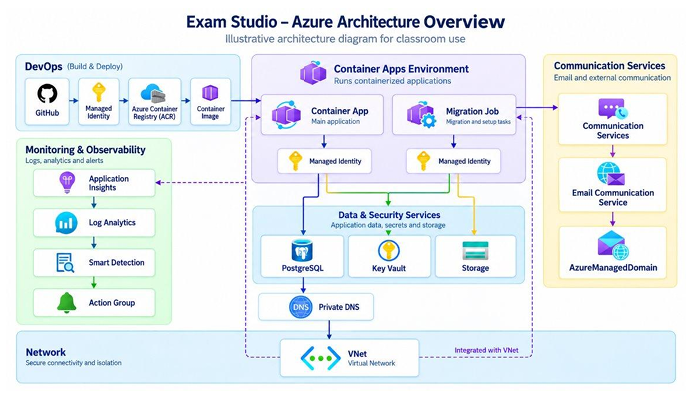

# CloudPublic GS: Arquitetura Azure lab-popovici-01

Entrega consolidada do laboratório **lab-popovici-01**, uma arquitetura cloud-native no Microsoft Azure implantada manualmente com a Azure CLI. O repositório reúne a documentação técnica, o vídeo explicativo e as evidências da implantação.

- **Autor:** Nickolas Corazza Alve
- **RM:** 562265
- **Ambiente:** Microsoft Azure, região Brazil South, assinatura Azure for Students
- **Implantação:** 01/10/2026, com Azure CLI 2.90.0 no Azure Cloud Shell (PowerShell)
- **Resource Group:** `rg-lab-popovici-01`

## Entregas

| Entrega | Onde está |
|---|---|
| Documentação técnica (artigo no formato IEEE) | [PDF](documentacao/Documentacao_IEEE_lab-popovici-01.pdf) · [Word](documentacao/Documentacao_IEEE_lab-popovici-01.docx) |
| Vídeo explicativo | [Google Drive](https://drive.google.com/file/d/1O1jlUvjGeHAX6kF-rL8ypdPN62crsUy0/view?usp=sharing) (arquivo `CloudPublic-Video-Explicativo.mkv`) |
| Evidências da implantação (25 capturas de tela, com descrição de cada uma) | [evidencias/](evidencias/README.md) |
| Diagrama da arquitetura | [documentacao/arquitetura.png](documentacao/arquitetura.png) |

> **Sobre o vídeo:** o arquivo (`.mkv`, cerca de 446 MiB) é grande demais para o repositório, porque o GitHub bloqueia arquivos acima de 100 MiB. Por isso ele está hospedado no Google Drive e é acessado por link. Se o navegador não reproduzir o formato `.mkv`, baixe o arquivo e abra em um player como o VLC.

## Cenário de negócio (fictício)

Uma startup brasileira de SaaS, com capital limitado e equipe de infraestrutura reduzida, precisa publicar uma aplicação web que armazena dados pessoais de clientes, envia e-mails transacionais e é operada com pouco esforço. A arquitetura foi desenhada para atender a estes requisitos:

| Requisito de negócio | Decisão técnica |
|---|---|
| Proteger dados pessoais | PostgreSQL com acesso público desabilitado, em sub-rede delegada, com DNS privado |
| Evitar vazamento de credenciais | Identidades gerenciadas, Key Vault com RBAC, ACR sem usuário administrador |
| Menor privilégio | Identidades separadas para a aplicação e para o *job* |
| Pagar só pelo que usa | Container App com escala a zero, PostgreSQL pausável, *job* sob demanda |
| Notificar clientes | Azure Communication Services com domínio gerenciado |
| Detectar falhas | Log Analytics, Application Insights e Action Group |

> O cenário é **fictício**, criado para fins acadêmicos. A conformidade com a LGPD (Lei nº 13.709/2018) depende também de processos e políticas organizacionais; este trabalho trata apenas de controles técnicos de rede e identidade.

## Arquitetura



*A seta tracejada indica um caminho de rede que existe, mas não foi exercitado, porque a aplicação de exemplo não se conecta ao banco.*

| Camada | Recursos |
|---|---|
| Rede | VNet `10.20.0.0/16`, sub-redes `snet-containerapps` (`10.20.0.0/23`) e `snet-postgresql` (`10.20.2.0/24`), Private DNS Zone e link com a VNet |
| Execução | Container Apps Environment (workload profiles), Container App e *job* manual |
| DevOps | Azure Container Registry (Basic) com a imagem `lab-app:v1` |
| Identidade | Duas identidades gerenciadas: `lab-popovici-01-identity` (aplicação) e `lab-popovici-01-migration` (*job*) |
| Dados | PostgreSQL Flexible Server 16 (`Standard_B1ms`, Burstable) e banco `labdb` |
| Segredos e arquivos | Key Vault (RBAC) com o segredo `LabSecret` e Storage Account (`Standard_LRS`) com o container `appfiles` |
| Observabilidade | Log Analytics, Application Insights e Action Group |
| Comunicação | Communication Services, Email Communication Service e `AzureManagedDomain` |

O `az resource list` retornou **19 recursos** no Resource Group, incluindo o link da zona DNS, o domínio de e-mail e o Action Group *Application Insights Smart Detection*, criado automaticamente. O Azure também criou um grupo gerenciado (`ME_...`) para a infraestrutura do ambiente de Container Apps.

### Permissões (RBAC)

| Identidade | Função | Escopo |
|---|---|---|
| Aplicação | Key Vault Secrets User | Key Vault |
| Aplicação | Storage Blob Data Reader | Storage Account |
| Aplicação | AcrPull | ACR |
| *Job* | AcrPull | ACR |

## Validação

O checklist de 16 itens do roteiro foi cumprido, todos com evidência. Resumo:

| Verificação | Resultado |
|---|---|
| Sub-redes e delegação | Conforme esperado |
| Link da Private DNS Zone | `Completed` / `Succeeded` |
| PostgreSQL | `Ready`, acesso público desabilitado, IP privado `10.20.2.4` |
| ACR | Tag `lab-app:v1` presente, usuário administrador desabilitado |
| Container Apps Environment | `Succeeded`, em Brazil South |
| Container App | Revisão `Healthy`; endpoint HTTPS público respondeu com a página de exemplo |
| Segredo no Container App | `LAB_SECRET` referencia o `labsecret` por `secretRef`; o valor permanece no Key Vault |
| *Job* | Iniciado manualmente; execução registrada, estado final `Failed` |
| Communication Services | `Succeeded`; DKIM, SPF e DMARC verificados |
| Action Group | Ativo, com receptor de e-mail habilitado |

## Desvios do roteiro

| # | Desvio | Justificativa |
|---|---|---|
| 1 | Região `brazilsouth`, em vez de `eastus` | O SKU `Standard_B1ms` foi listado só em `brazilsouth` entre as três regiões testadas; a causa não foi investigada |
| 2 | Sufixo no nome do Key Vault | Nomes de Key Vault são globais |
| 3 | Funções de dados atribuídas ao usuário | Com RBAC, ser proprietário não dá acesso ao plano de dados (`Key Vault Secrets Officer` e `Storage Blob Data Contributor`) |
| 4 | Delegação da `snet-containerapps` a `Microsoft.App/environments` e *workload profiles* | Aplicada preventivamente; o comportamento sem ela não foi testado |
| 5 | *Job* criado em etapas | A criação direta com `--registry-identity` falhou com `IdentityDoesNotExist` |
| 6 | Segredo referenciado sem versão | A aplicação usa a versão mais recente |
| 7 | Parâmetro `--name` no lugar de `--database-name` e `--domain-name` | Exigido pela versão da CLI usada |
| 8 | E-mail real no Action Group | O endereço fictício do roteiro notificaria terceiros |

**Falha na criação do *job*:** a causa do `IdentityDoesNotExist` **não foi confirmada**. A hipótese é uma limitação da extensão `containerapp` (em preview) ao combinar identidade e registry na criação de *jobs*. O contorno foi criar o *job* sem registry, atribuir a identidade, configurar o registry com ela e só então atualizar a imagem para a do ACR.

## Custos observados

Dados do Azure Cost Management, de 02 a 08/10/2026 (o dia 01/10, da criação, não está no período filtrado):

| Resource Group | US$ | R$ | US$/dia* |
|---|---|---|---|
| `rg-lab-popovici-01` | 1,23 | 6,44 | 0,18 |
| Grupo gerenciado `ME_...` | 0,82 | 4,25 | 0,12 |
| **Total** | **2,05** | **10,70** | **0,30** |

\*Média dos dias completos (02 a 07/10); o dia 08/10 parece parcial (hipótese).

- O total equivale a cerca de 0,7% do crédito inicial de US$ 312.
- O grupo `ME_` contém somente um IP público e um *load balancer* e custou US$ 0,12 por dia mesmo com a aplicação escalada a zero.
- A exportação agrupa por Resource Group, e não por recurso. **Hipótese não confirmada:** a maior parte do custo do grupo principal seria o ACR Basic, que tem tarifa diária fixa.
- A extrapolação linear (cálculo do autor, não previsão do Azure) daria cerca de US$ 9 por mês.
- Medidas de economia aplicadas, ambas reversíveis: parada do PostgreSQL (o armazenamento continua cobrado e o Azure reinicia o servidor após 7 dias) e `minReplicas 0` no Container App.

## Limitações

Este é um **ambiente de laboratório**, e não uma arquitetura de produção.

- Sem redundância de zona, PostgreSQL em tier Burstable e Storage `Standard_LRS`.
- A aplicação tem *ingress* externo; Key Vault, ACR e Storage aceitam conexões pela rede pública (com autenticação). Somente o PostgreSQL é privado.
- O Key Vault tem *soft delete* de 90 dias, mas sem proteção contra purga.
- O Action Group não tem regra de alerta associada; nenhum e-mail foi enviado, e o domínio de e-mail não foi associado ao Communication Services.
- A imagem de exemplo não se conecta ao banco.
- A execução do *job* terminou como `Failed`, e a causa **não foi comprovada**. Uma hipótese plausível é que a imagem de exemplo é um servidor web que não termina sozinho e o *timeout* de 120 s encerrou a execução. A investigação por logs não foi concluída.
- A extensão `containerapp` e o grupo `communication email` estavam em preview.

**Trabalhos futuros:** *private endpoints* e proteção contra purga, regras de alerta, investigação do *job* por logs, envio de e-mail de teste, exportação de custos por recurso, automação por *scripts* ou infraestrutura como código e avaliação pelo Azure Well-Architected Framework.

## Convenções do ambiente

Os nomes dos recursos são padronizados por variáveis (`$PREFIX = lab-popovici-01`). Serviços com nome global (ACR, Storage, Key Vault e PostgreSQL) usam o sufixo numérico `4827` para evitar colisão.

## Estrutura do repositório

```
CloudPublic_GS/
├── README.md
├── documentacao/
│   ├── Documentacao_IEEE_lab-popovici-01.docx
│   ├── Documentacao_IEEE_lab-popovici-01.pdf
│   └── arquitetura.png
└── evidencias/
    ├── README.md            (descrição de cada captura de tela)
    ├── Print 1 ... Print 25 (capturas de tela)
    ├── CLOUDPUBLIC-CP2.docx
    └── CLOUDPUBLIC-CP2.pdf
```

O vídeo não faz parte da árvore de arquivos; ele está no [Google Drive](https://drive.google.com/file/d/1O1jlUvjGeHAX6kF-rL8ypdPN62crsUy0/view?usp=sharing).
